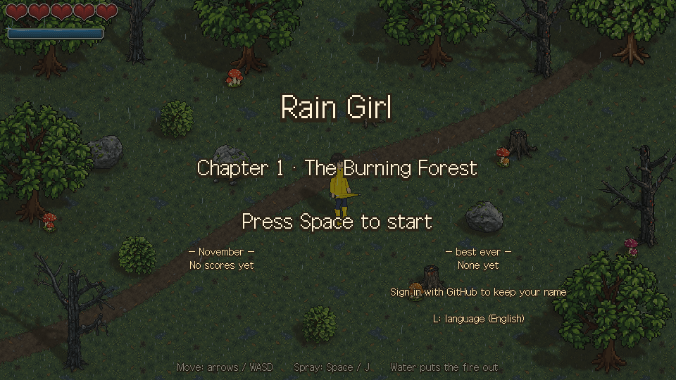

<h1 align="center">Rain Girl</h1>

<p align="center"><b>Un bosque bajo la lluvia está en llamas. Una niña con impermeable amarillo tiene un paraguas lleno de agua.</b><br>
Un pequeño juego de acción en pixel art que se juega en el navegador: sin instalar nada y sin cuenta.</p>

<p align="center"><a href="https://sunghwan0112.github.io/rain-girl/"><b>▶ Jugar ahora</b></a> &nbsp;·&nbsp; <a href="#how">Cómo se juega</a> &nbsp;·&nbsp; <a href="#board">Clasificación</a> &nbsp;·&nbsp; <a href="#made">Cómo se hizo</a></p>

<p align="center"><a href="https://sunghwan0112.github.io/rain-girl/"></a></p>

<p align="center"><a href="README.md">English</a> · <a href="README.ko.md">한국어</a> · <a href="README.ja.md">日本語</a> · <a href="README.zh-CN.md">简体中文</a> · <b>Español</b> · <a href="README.pt-BR.md">Português</a> <i>(pulsa L en la pantalla de título para cambiar el idioma del juego)</i></p>

<a name="how"></a>
## Cómo se juega

| | |
|---|---|
| **Moverse** | flechas / WASD |
| **Agitar el paraguas (lanzar agua)** | Space / J |
| **Cambiar el idioma** | L, en la pantalla de título |
| **Jugar otra vez** | R |
| **En móvil o tableta** | pulgar izquierdo: mover · pulgar derecho: agitar el paraguas · toca para empezar (el juego pasa al modo táctil solo) |

Los monstruos de fuego saltan por el bosque. Donde caen, la hierba prende; el fuego se extiende, el suelo en llamas te corta el paso y los árboles arden. Apaga a los monstruos, y los fuegos que dejan, antes de que se queme el bosque.

- **El agua se acaba.** Cada golpe gasta agua; la lluvia vuelve a llenar el depósito, tres veces más rápido si estás en un charco.
- **El viento cambia en cada ronda.** La lluvia se inclina con él, los árboles se doblan y el fuego se extiende hacia donde sopla.
- **Salva los árboles.** Un árbol que prende se salva con agua en 4 segundos. Más tarde queda medio quemado; si lo dejas, se quema del todo.
- **Llévalos al agua.** Un fuego que cae en un charco silba y pierde una vida: dos o tres caídas apagan uno pequeño. Pero hace hervir el charco, que se seca antes.
- **Usa la cobertura.** Las bolas de fuego se rompen contra rocas y troncos, aunque un árbol verde alcanzado puede prender.
- **La puntuación mira el bosque.** Fuegos apagados, tiempo y cuánto bosque se salvó; los golpes recibidos restan puntos. Hasta tres estrellas por ronda.

**Diez rondas** de fuegos rojos, verdes, morados y azules: los verdes son rápidos y se extienden, los morados lanzan tres bolas de fuego, los azules necesitan más agua. En la última, un jefe azul con corona.

<p align="center"></p>

<a name="board"></a>
## Clasificación

<p align="center"></p>

Los diez mejores del mes y los tres mejores de siempre, en la pantalla de título del juego y aquí. Al terminar una partida, **inicia sesión con GitHub** para publicar con tu nombre de GitHub (marcado con **@**), o publica como invitado. La base de datos comprueba cada puntuación antes de mostrarla: se rechaza la que una partida real no puede dar, y nadie puede publicar con el nombre de GitHub de otro. La imagen de arriba se vuelve a dibujar cada media hora.

<a name="made"></a>
## Cómo se hizo

La niña, los árboles, las rocas y los arbustos se hicieron con **[SpriteCast](https://github.com/Sunghwan0112/spritecast)**, una skill de Claude Code que convierte un modelo 3D en sprites de pixel art con el ángulo de cámara del juego.

<p align="center"></p>

- **La niña**: una ilustración, un modelo 3D, y una caminata, un golpe y una pose de pie con rig, renderizados con la cámara isométrica 2:1 del juego en cuatro direcciones; cada fotograma redibujado como pixel art de 96 px. El agua que lanza es un efecto 3D dibujado igual.
- **El bosque**: siete objetos hechos a partir de modelos 3D, cuatro lados cada uno, todos con una sola paleta de 48 colores. Cada uno muestra un lado al azar, así que no hay dos bosques iguales; un árbol que arde pasa a medio quemado y luego a quemado, desde el lado en que estaba.
- **Una sola luz, sombras de verdad**: todos los objetos están iluminados por el mismo sol, y su sombra en el suelo está horneada desde su modelo 3D: oscura junto al tronco, más pálida donde cae desde la copa. Si la niña entra en la sombra de un árbol, también se oscurece.
- **El 3D sigue trabajando**: dónde se rompe una bola de fuego sale de cada modelo, cortado a la altura de la bola: un tronco la para, la copa de arriba no.
- **Viento en las hojas**: las copas se mecen rama a rama. Las hojas se agrupan según dónde están en el modelo 3D y cada grupo se mueve entero, un píxel cada vez, con el viento de la ronda y más fuerte en una ráfaga. Sin fotogramas dibujados a mano. Las setas se quedan quietas y solo ceden un píxel en el sombrero cuando las empuja una ráfaga; los sombreros son rojos, naranjas y color vino.
- **El tiempo**: una noche oscura de lluvia iluminada por los fuegos, rayos y truenos, ondas de lluvia en los charcos, pasos según el suelo que pisa, y sonido desde donde ocurre.

Las reglas y todos los números están en [DESIGN.md](DESIGN.md).

## Ejecutarlo tú mismo

Es una página estática: sirve cualquier servidor web.

```
git clone https://github.com/Sunghwan0112/rain-girl.git
cd rain-girl && python3 -m http.server 8000      # luego abre http://localhost:8000
```

Si no configuras la clasificación en línea, el juego guarda una clasificación en tu navegador.

<details><summary><b>Tu propia clasificación en línea (Supabase, gratis)</b></summary>

1. Crea un proyecto en Supabase y ejecuta `supabase/schema.sql` en su SQL Editor: la tabla, sus reglas y las comprobaciones de puntuación.
2. Authentication -> Providers -> GitHub: actívalo, con una app OAuth de GitHub cuyo callback sea `https://<project>.supabase.co/auth/v1/callback`.
   Authentication -> URL Configuration: la dirección de tu juego como Site URL y en las Redirect URLs.
3. Pon la URL del proyecto y la clave anon en `ranking-config.js`. La clave anon es pública por diseño: la tabla solo deja leer la clasificación y añadir una puntuación comprobada.
4. `.github/workflows/leaderboard.yml` vuelve a dibujar `leaderboard.svg` cada media hora (`tools/leaderboard_svg.py`).

</details>

## Créditos

- **Motor**: [Phaser 3](https://phaser.io) (MIT)
- **Fuente**: [Galmuri11](https://github.com/quiple/galmuri) de Lee Minseo (SIL OFL 1.1, `assets/font/OFL.md`)
- **Arte**: hecho con [SpriteCast](https://github.com/Sunghwan0112/spritecast), modelos 3D de Tripo y modelos de imagen de GPT
- **Sonido**: sonidos CC0 de [Kenney](https://kenney.nl) y OpenGameArt, algunos hechos con código; música hecha con Suno: ver [`assets/audio/CREDITS.md`](assets/audio/CREDITS.md)

## Licencia

El **código** es MIT. El **arte, la música y el nombre** del juego no lo son: todos los derechos reservados. Juega, lee y aprende del código, pero no vuelvas a publicar ni vendas las imágenes y la música del juego. El trabajo de otras personas (Phaser, la fuente, los sonidos CC0) conserva su propia licencia. Ver [LICENSE](LICENSE).
