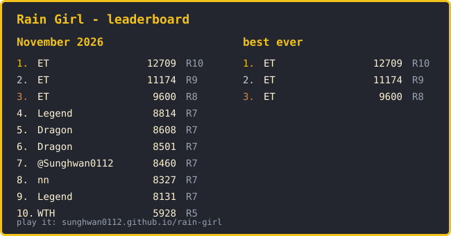

<h1 align="center">Rain Girl · 우비소녀의 여행</h1>

<p align="center"><b>A rainy forest is on fire. A girl in a yellow raincoat has an umbrella full of water.</b><br>
A small pixel-art action game you play in the browser - no install, no account.</p>

<p align="center"><a href="https://sunghwan0112.github.io/rain-girl/"><b>▶ Play it now</b></a> &nbsp;·&nbsp; <a href="#how-to-play">How to play</a> &nbsp;·&nbsp; <a href="#the-leaderboard">Leaderboard</a> &nbsp;·&nbsp; <a href="#how-it-was-made">How it was made</a> &nbsp;·&nbsp; <a href="README.ko.md">한국어</a></p>

<p align="center"><a href="https://sunghwan0112.github.io/rain-girl/"></a></p>

<p align="center">English · 한국어 · 日本語 · 简体中文 · Español · Português <i>(press L on the title screen)</i></p>

## How to play

| | |
|---|---|
| **Move** | arrow keys / WASD |
| **Swing the umbrella** (throw water) | Space / J |
| **Change the language** | L, on the title screen |
| **Play again** | R |

Fire monsters hop through the forest. Where they land, the grass catches; the fire spreads, burning ground blocks your way, and trees
go up in flames. Put the monsters out - and the fires they leave - before the forest burns.

- **Your water runs out.** Every swing costs water; the rain fills the tank again, three times as fast while you stand in a puddle.
- **The wind changes every round.** The rain slants with it, the trees lean, and the fire spreads its way.
- **Save the trees.** A tree that catches can be saved with water within 4 seconds. Later it is half burnt; left alone, it burns down.
- **Lead them into the water.** A fire that lands in a puddle hisses and loses a life - two or three landings put a small one out.
  But it boils the puddle away as it goes, and puddles dry up by themselves.
- **Use cover.** Fireballs break on rocks and tree trunks - but a green tree hit by one may catch.
- **The score counts the forest.** Fires put out, time, and how little of the forest burned; hits cost points. Up to three stars a round.

**Ten rounds** of red, green, purple and blue fires - green ones are fast and spread, purple ones throw three fireballs, blue ones take
more water - and in the last, a crowned blue boss.

<p align="center"></p>

## The leaderboard

<p align="center"></p>

This month's best ten and the best three ever - in the game's title screen and here. At the end of a game, **sign in with GitHub** to
post under your GitHub name (marked **@**), or post as a guest. Every score is checked by the database before it goes up: a score a
played game cannot make is refused, and nobody can post under someone else's GitHub name. The picture above is redrawn every half hour.

## How it was made

The girl, the trees, the rocks and the bushes were made with **[SpriteCast](https://github.com/Sunghwan0112/spritecast)** - a Claude
Code skill that turns a 3D model into pixel-art sprites at a game's camera angle.

<p align="center"></p>

- **The girl**: one illustration, a 3D model, a rigged walk, swing and idle rendered at the game's 2:1 isometric camera in four
  facings, each frame redrawn as 96 px pixel art. The water she throws is a 3D effect drawn the same way.
- **The forest**: seven props from 3D models, four sides each, all on one 48-colour palette. Each shows one side at random, so no two
  forests look the same; a tree that burns goes half-burnt, then burnt, from the side it stood.
- **One light, real shadows**: every prop is lit from the same sun, and its shadow on the ground is baked from its 3D model - dark by
  the trunk, paler where it falls from the crown. Walk into a tree's shade and the girl darkens too.
- **The 3D keeps working**: where a fireball breaks on cover comes from each model, cut at the fireball's height - a trunk stops it,
  the crown above does not.
- **Wind in the leaves**: the crowns sway bough by bough. The leaves are grouped into clumps by where they are on the 3D model,
  and each clump moves whole, a pixel at a time - with the round's wind, harder in a gust. No hand-drawn frames.
  The mushrooms stand still and give a pixel at the cap when a gust leans on them; their caps come red, orange and wine.
- **The weather**: a dark rainy night lit by the fires, lightning and thunder, rain rings on the puddles, footsteps by the ground under
  her, sound from where it happens.

The rules and every number are in [DESIGN.md](DESIGN.md).

## Run it yourself

It is a static page - any web server works:

```
git clone https://github.com/Sunghwan0112/rain-girl.git
cd rain-girl && python3 -m http.server 8000      # then open http://localhost:8000
```

Without the online board set up, the game keeps a leaderboard in your browser.

<details><summary><b>Your own online leaderboard (Supabase, free)</b></summary>

1. Make a Supabase project; run `supabase/schema.sql` in its SQL editor - the table, its rules and the score checks.
2. Authentication -> Providers -> GitHub: on, with a GitHub OAuth app whose callback is `https://<project>.supabase.co/auth/v1/callback`.
   Authentication -> URL Configuration: your game's address as the Site URL and in the redirect URLs.
3. Put the project's URL and anon key in `ranking-config.js`. The anon key is public by design: the table only lets anyone read the
   board and add a checked score.
4. `.github/workflows/leaderboard.yml` redraws `leaderboard.svg` every half hour (`tools/leaderboard_svg.py`).

</details>

## Credits

- **Engine**: [Phaser 3](https://phaser.io) (MIT).
- **Font**: [Galmuri11](https://github.com/quiple/galmuri) by Lee Minseo (SIL OFL 1.1, `assets/font/OFL.md`).
- **Art**: made with [SpriteCast](https://github.com/Sunghwan0112/spritecast), Tripo 3D models and GPT image models.
- **Sound**: CC0 sounds from [Kenney](https://kenney.nl) and OpenGameArt, some made in code; music made with Suno - see
  [`assets/audio/CREDITS.md`](assets/audio/CREDITS.md).

## Licence

The **code** is MIT. The game's **art, music and name** are not: all rights reserved - play it, read it, learn from the code, but
do not publish or sell the game's pictures and music again. Other people's work (Phaser, the font, the CC0 sounds) keeps its own
licence. See [LICENSE](LICENSE).
