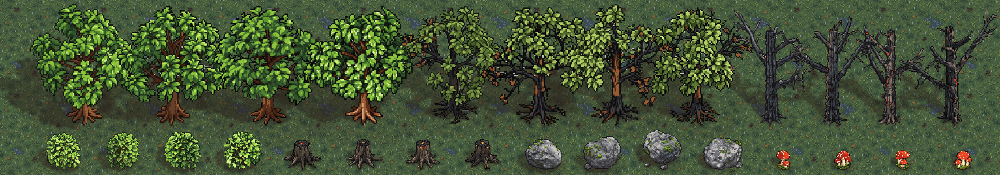

<h1 align="center">雨衣女孩</h1>

<p align="center"><b>下着雨的森林着火了。穿黄色雨衣的女孩有一把装满水的伞。</b><br>
一个在浏览器里直接玩的像素风小动作游戏 —— 不用安装,不用注册。</p>

<p align="center"><a href="https://sunghwan0112.github.io/rain-girl/"><b>▶ 现在就玩</b></a> &nbsp;·&nbsp; <a href="#how">玩法</a> &nbsp;·&nbsp; <a href="#board">排行榜</a> &nbsp;·&nbsp; <a href="#made">制作方法</a></p>

<p align="center"><a href="https://sunghwan0112.github.io/rain-girl/"></a></p>

<p align="center"><a href="README.md">English</a> · <a href="README.ko.md">한국어</a> · <a href="README.ja.md">日本語</a> · <b>简体中文</b> · <a href="README.es.md">Español</a> · <a href="README.pt-BR.md">Português</a> <i>(在标题画面按 L 切换游戏语言)</i></p>

<a name="how"></a>
## 玩法

| | |
|---|---|
| **移动** | 方向键 / WASD |
| **挥伞(洒水)** | Space / J |
| **切换语言** | 在标题画面按 L |
| **再玩一次** | R |

火焰怪物在森林里跳来跳去。它们落下的地方草会着火,火会蔓延,燃烧的地面会挡住去路,树也会烧起来。在森林烧光之前,把怪物和它们留下的火扑灭。

- **水会用完。** 每挥一次都会耗水,雨会重新把水装满;站在水坑里装得快三倍。
- **每一回合风向都会变。** 雨随风倾斜,树被吹弯,火也顺着风蔓延。
- **保护树木。** 树着火后 4 秒内洒水就能救下。晚了会烧掉一半;放着不管就会烧光。
- **把它们引进水里。** 火焰落进水坑会嘶地一声并少一点生命 —— 小火焰落两三次就灭了。不过水坑也会被煮掉一些,干得更快。
- **利用掩体。** 火球会被岩石和树干挡住 —— 但被击中的绿树可能着火。
- **分数看森林。** 扑灭的火、用掉的时间、森林保住了多少;被击中会扣分。每回合最多三颗星。

红、绿、紫、蓝四种火焰,共 **10 个回合**。绿色的快而且蔓延得广,紫色的一次扔三个火球,蓝色的要更多水。最后一回合会出现戴王冠的蓝色首领。

<p align="center"></p>

<a name="board"></a>
## 排行榜

<p align="center"></p>

本月前十和历史前三会显示在游戏标题画面和这里。游戏结束后,可以**用 GitHub 登录**,以你的 GitHub 名字(带 **@**)提交,也可以用访客名提交。每个分数都先由数据库检查:实际游戏打不出来的分数会被拒绝,也不能冒用别人的 GitHub 名字。上面的图片每半小时重画一次。

<a name="made"></a>
## 制作方法

女孩、树、岩石和灌木都是用 **[SpriteCast](https://github.com/Sunghwan0112/spritecast)** 做的 —— 一个把 3D 模型变成游戏镜头角度的像素风精灵图的 Claude Code 技能。

<p align="center"></p>

- **女孩**: 一张插画 → 3D 模型 → 绑定骨骼的行走、挥动和站立,用游戏的 2:1 等距镜头渲染四个朝向 → 每一帧重画成 96 px 的像素画。她洒出的水也是用同样方法画的 3D 特效。
- **森林**: 七个由 3D 模型做成的道具,每个四个面,全部统一到一个 48 色调色板。每局随机显示一个面,所以森林每次都不一样;烧起来的树会按原来站的那一面变成半焦、再变成烧焦。
- **同一束光,真实的阴影**: 所有道具都被同一个太阳照亮,地面上的阴影由 3D 模型烘焙 —— 树干旁最深,树冠投下的较淡。女孩走进树荫也会变暗。
- **3D 在游戏里继续发挥作用**: 火球在哪里被挡住,是把每个模型在火球的高度切开决定的 —— 树干挡得住,上面的树冠挡不住。
- **叶间的风**: 树冠是一枝一枝地摇。叶子按它们在 3D 模型上的位置分成叶团,每个叶团整体移动,一次一个像素 —— 顺着这一回合的风,阵风时更猛。没有手绘的帧。蘑菇平时不动,只有阵风吹来时菌盖才偏一个像素;菌盖有红色、橙色和酒红色。
- **天气**: 被火光照亮的雨夜,闪电和雷声,水坑上的雨圈,随地面变化的脚步声,从发生的位置传来的声音。

规则和所有数值都在 [DESIGN.md](DESIGN.md) 里。

## 自己运行

这是一个静态页面,任何网页服务器都可以:

```
git clone https://github.com/Sunghwan0112/rain-girl.git
cd rain-girl && python3 -m http.server 8000      # 然后打开 http://localhost:8000
```

没有设置在线排行榜时,游戏会把排行榜保存在你的浏览器里。

<details><summary><b>自己的在线排行榜(Supabase,免费)</b></summary>

1. 创建一个 Supabase 项目,在 SQL Editor 里运行 `supabase/schema.sql` —— 建好表、规则和分数检查。
2. Authentication -> Providers -> GitHub:打开,GitHub OAuth 应用的 callback 是 `https://<project>.supabase.co/auth/v1/callback`。
   Authentication -> URL Configuration:把游戏地址填为 Site URL 和 Redirect URL。
3. 把项目的 URL 和 anon key 填进 `ranking-config.js`。anon key 本来就是公开的:这张表只允许任何人读取排行榜、添加通过检查的分数。
4. `.github/workflows/leaderboard.yml` 每半小时重画一次 `leaderboard.svg`(`tools/leaderboard_svg.py`)。

</details>

## 致谢

- **引擎**: [Phaser 3](https://phaser.io)(MIT)
- **字体**: Lee Minseo 的 [Galmuri11](https://github.com/quiple/galmuri)(SIL OFL 1.1,`assets/font/OFL.md`)
- **美术**: 用 [SpriteCast](https://github.com/Sunghwan0112/spritecast)、Tripo 3D 模型和 GPT 图像模型制作
- **声音**: [Kenney](https://kenney.nl) 和 OpenGameArt 的 CC0 音效、用代码生成的声音、用 Suno 制作的音乐 —— 见 [`assets/audio/CREDITS.md`](assets/audio/CREDITS.md)

## 许可

**代码**是 MIT。游戏的**美术、音乐和名称**不是:保留所有权利 —— 欢迎游玩、阅读、从代码里学习,但不要重新发布或出售游戏的图片和音乐。其他人的作品(Phaser、字体、CC0 音效)各自遵循自己的许可。见 [LICENSE](LICENSE)。
